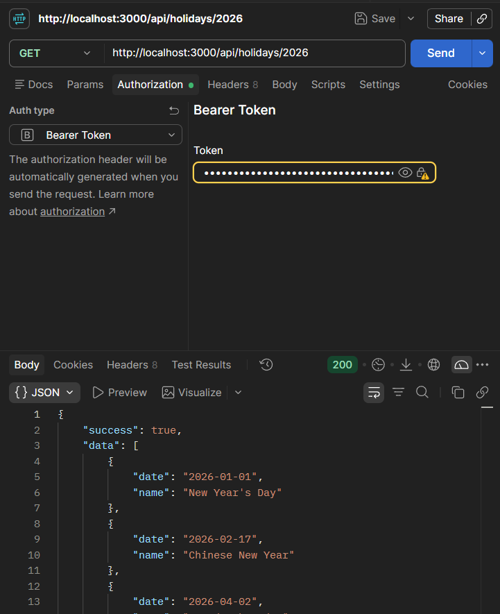
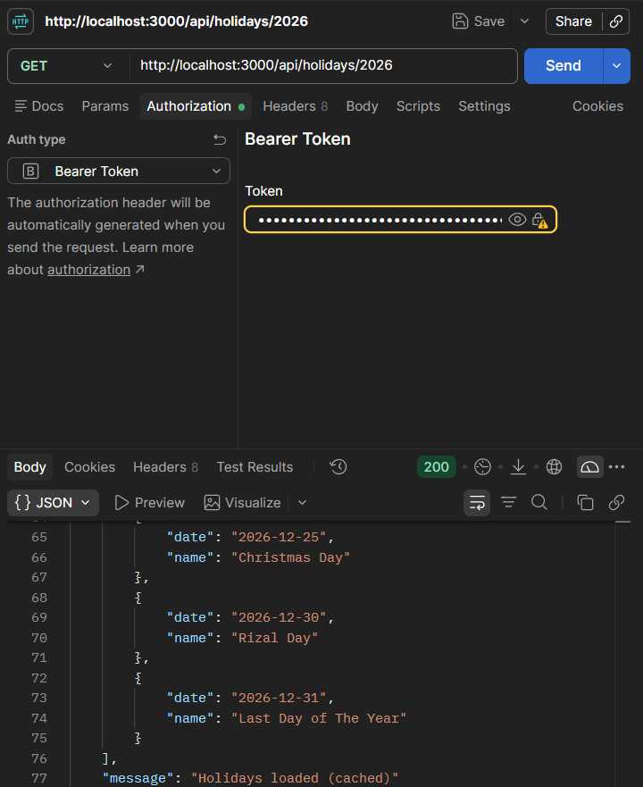
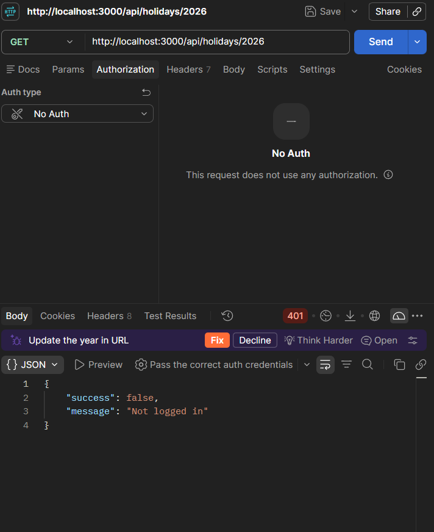
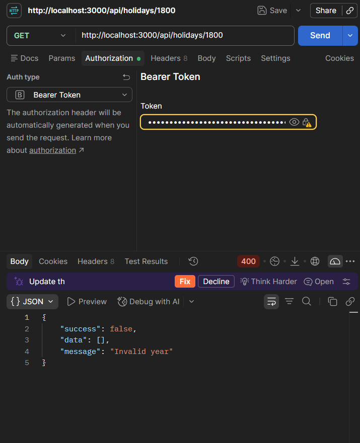

# API Integration Documentation

## Perfect Smile Maker – Phase 4

### 1. External API Overview

*API Name:* Nager.Date Public Holidays API

*Country:* Philippines

*Country Code:* PH

*API Provider:* Nager.Date

*API Documentation:* [Nager.Date](https://date.nager.at/)

The Perfect Smile Maker system integrates the Nager.Date Public Holidays API to retrieve public holiday information in the Philippines.

The purpose of this integration is to provide Philippine public holiday information to support appointment scheduling and help clinic staff identify holidays when managing appointments.

The API does not require an API key.

### 2. API Endpoint

*External API URL:*

https://date.nager.at/api/v3/PublicHolidays/{year}/PH

*Example:*

https://date.nager.at/api/v3/PublicHolidays/2026/PH

*HTTP Method:* GET

*Parameters:*

| Path Component | Description | Example |
|---|---|---|
| year | The year of the requested holidays | 2026 |
| PH | Country code for the Philippines | PH |

The backend retrieves the holiday information and extracts the date and name fields before returning the data to the application.

### 3. Internal API Endpoint

The frontend accesses the holiday information through the Perfect Smile Maker backend.

*Endpoint:* GET /api/holidays/{year}

*Local Testing URL:* http://localhost:3000/api/holidays/2026

*Authentication:* Required

*Authorization Type:* Bearer Token

*Example Request Header:*

Authorization: Bearer YOUR_JWT_TOKEN

The endpoint requires an authenticated user. Requests without a valid JWT token are rejected.

### 4. Sample API Request

*Method:* GET

*URL:* http://localhost:3000/api/holidays/2026

*Authorization:*
- Type: Bearer Token
- Token: Valid Owner or Receptionist JWT token

No request body is required because this endpoint uses the GET method.

### 5. Sample API Response

*Successful Response – HTTP 200 OK*

The backend returns the holiday information using the following response structure:

{
  "success": true,
  "data": [
    {
      "date": "YYYY-MM-DD",
      "name": "Holiday Name"
    }
  ],
  "message": "Holidays loaded"
}

The date and holiday name values above illustrate the response structure. Actual values depend on the selected year and the data returned by Nager.Date.

*Cached Response – HTTP 200 OK*

When the requested year's holiday data is already stored in the backend cache, the backend returns the cached data.

{
  "success": true,
  "data": [
    {
      "date": "YYYY-MM-DD",
      "name": "Holiday Name"
    }
  ],
  "message": "Holidays loaded (cached)"
}

### 6. Error Handling

The backend handles invalid requests and external API failures.

| HTTP Status | Condition | Response Message |
|---|---|---|
| 400 Bad Request | Invalid year parameter | Invalid year |
| 401 Unauthorized | Missing or invalid authentication token | Not logged in / Session expired |
| 502 Bad Gateway | External Nager.Date API is unavailable or fails | Holiday service unavailable |

*Example: Invalid Year – HTTP 400*

{
  "success": false,
  "data": [],
  "message": "Invalid year"
}

*Example: External API Failure – HTTP 502*

{
  "success": false,
  "data": [],
  "message": "Holiday service unavailable"
}

The backend uses a 5-second timeout for the external API request. If the request fails, returns an unsuccessful HTTP status, or times out, the backend responds with HTTP 502.

The failure of the external holiday service does not prevent the rest of the application from functioning.

### 7. Caching Mechanism

The backend uses an in-memory JavaScript Map to cache holiday results by year.

The caching mechanism:
- Stores successfully retrieved holiday data.
- Uses the requested year as the cache key.
- Returns cached data when the same year is requested again.
- Prevents unnecessary repeated requests to the external API.

The cache is stored in application memory and is cleared when the backend server restarts.

### 8. Postman Testing Evidence

The following tests were performed using Postman:

| Test Scenario | Expected Result | Actual Result |
|---|---|---|
| Request holidays with a valid token | 200 OK | Passed |
| Request the same year again | 200 OK with cached message | Passed |
| Request without authentication | 401 Unauthorized | Passed |
| Request with an invalid year | 400 Bad Request | Passed |
| Simulated external API failure | 502 Bad Gateway | Passed in automated test |

*Postman Screenshots*

1. Successful holiday API request (200 OK).

2. Cached holiday API response (200 OK).

3. Unauthorized request (401).

4. Invalid year request (400).

The external API failure handling was also verified through an automated test in backend/tests/health.test.js, which simulated an unavailable Nager.Date service and confirmed the expected HTTP 502 response.

### 9. Conclusion

The Nager.Date Public Holidays API was successfully integrated into the Perfect Smile Maker backend.

The integration allows authenticated users to retrieve Philippine public holiday information by year. The backend also implements caching, input validation, authentication, and error handling to support reliable API communication.

This integration supports the clinic's appointment scheduling process by providing holiday information while ensuring that external API failures do not interrupt the other system functions.
